# 매너볼트 (Manner-Volt)

> 팀 그린라이트 · 현대자동차그룹 차량용 앱 개발 공모전 출품작

## 1. 앱 이름 및 한 줄 소개

- **앱 이름**: 매너볼트 (Manner-Volt)
- **한 줄 소개**: 충전 중인 차가 직접 "언제 나갈지"를 알려 주고, 그 약속이 지켜졌는지 차량 데이터로 확인하는 Pleos Connect 차량용 앱입니다.

## 2. 실행 방법

1. Android Studio Device Manager에서 **Pleos Connect v2.1.0** 에뮬레이터를 실행합니다.
2. APK를 설치하고 실행합니다. `-g`는 위치 권한을 함께 허용합니다.
   ```bash
   adb install -r -g apk/그린라이트_매너볼트_release.apk
   adb shell am start -n com.mannervolt/.MainActivity
   ```
3. 앱이 **시뮬레이터** 탭에서 열립니다. **다음 단계 ▶**를 누르면 기획서 4항 시나리오가 순서대로 진행됩니다.

계정, API 키, 서버 없이 APK만으로 실행됩니다.

## 3. 테스트 환경 및 필요한 설정

| 항목 | 값 |
|---|---|
| 에뮬레이터 | Pleos Connect v2.1.0 (Android Studio Device Manager) |
| OS / ABI | Android 14 (API 34), arm64-v8a |
| 앱 빌드 | minSdk 28, targetSdk 34, Kotlin, Jetpack Compose |
| 개발 PC | macOS (Apple Silicon), Android Studio, JDK 17 이상 |

필요한 설정은 다음과 같습니다.

- **계정, API 키, 서버가 필요 없습니다.** APK는 앱 안의 시연 서버와 샘플 데이터로 동작합니다.
- **위치 권한**: 설치 명령의 `-g`가 함께 허용합니다. `-g` 없이 설치했다면 앱 첫 실행 때 허용해 주세요.
- **Pleos 차량 권한** (`pleos.car.permission.CAR_ENERGY` 등): 에뮬레이터에서 자동으로 허용됩니다.
- **인터넷**: 주변 충전소 탭의 지도 타일을 받을 때만 필요합니다. 나머지 기능은 인터넷 없이 동작합니다.
- **음성 안내**: 운전 중 안내를 들으려면 에뮬레이터 소리를 켜 주세요.

## 4. 개발에 사용한 Pleos Connect 에뮬레이터 버전과 화면 규격

| 항목 | 값 |
|---|---|
| 에뮬레이터 버전 | Pleos Connect v2.1.0 |
| 화면 규격 | 2560 × 1440 px, 160 dpi, 가로 화면 |
| Pleos SDK | Vehicle 2.3.2, NaviHelper 3.0.5, TextToSpeech 3.3.1 |

## 5. APK 파일 위치

- [`apk/그린라이트_매너볼트_release.apk`](apk/그린라이트_매너볼트_release.apk) (release 빌드, 버전 0.3.0)

---

## 주요 기능

- **꽂기만 하면 됩니다.** 꽂은 시각에 공공데이터에서 '충전 중'으로 바뀐 충전기를 찾아 "3번 충전기 맞나요?"를 한 번만 묻습니다. 지하 주차장 GPS에 의존하지 않습니다.
- 충전기 출력과 배터리 %로 충전 완료 시각을 바로 추정해 보여 주고, 몇 분 뒤 실제 충전 속도로 다시 계산합니다. 운전자의 평소 출차 지연을 더한 추천 시각을 하차 전에 한 번 눌러 확정합니다. 출차 예정은 완충 후 최대 30분까지만 고를 수 있습니다.
- 확정한 시각은 단지 충전소 배치도에 "충전 완료 예상 / 출차 예정 / 매너볼트"로 공유됩니다. 기다리는 운전자는 퇴근길 운전 중에 내비 도착 예정 시간과 충전기가 비는 시각을 비교한 카드 한 장과 음성 안내를 받습니다.
- 충전기 분리 + 기어 D + 충전 구역 이탈로 실제 출차를 판단하고, 약속을 지켰는지에 따라 매너볼트(V)가 오르내립니다.

| 충전기 자동 매칭 | 출차 시각 추천 (완충 + 30분 상한) | 충전소 배치도 |
|---|---|---|
| 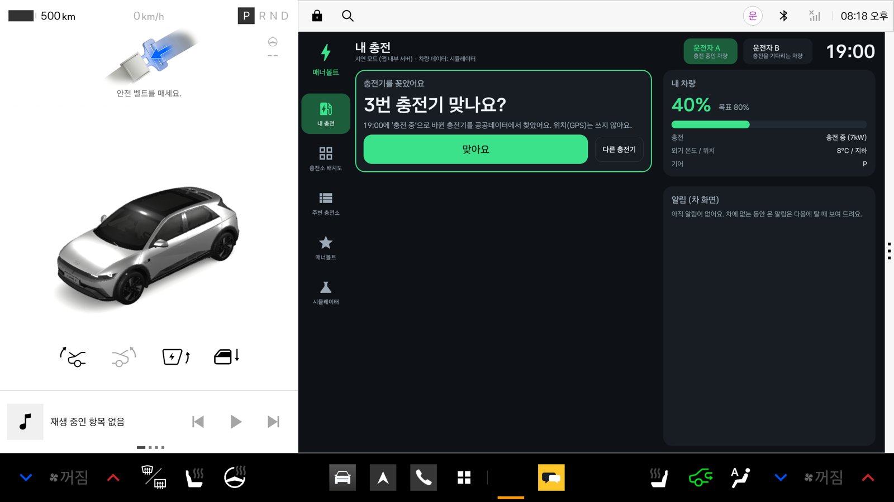 | 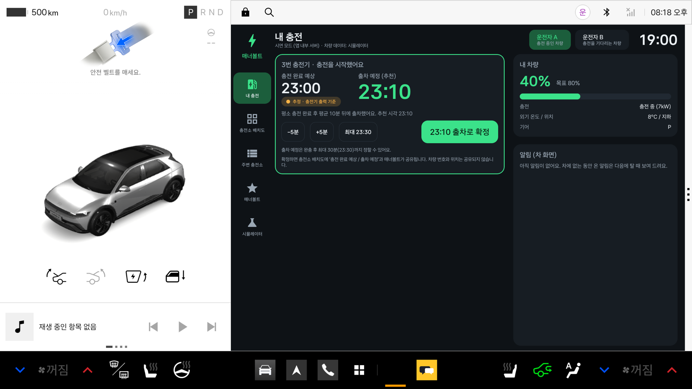 | 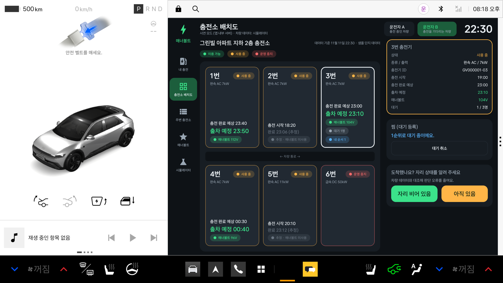 |

| 퇴근길 운전 중 (터치 없음 + 음성) | 충전 속도 변화 → 출차 변경 제안 | 출차 확인 알림 |
|---|---|---|
| 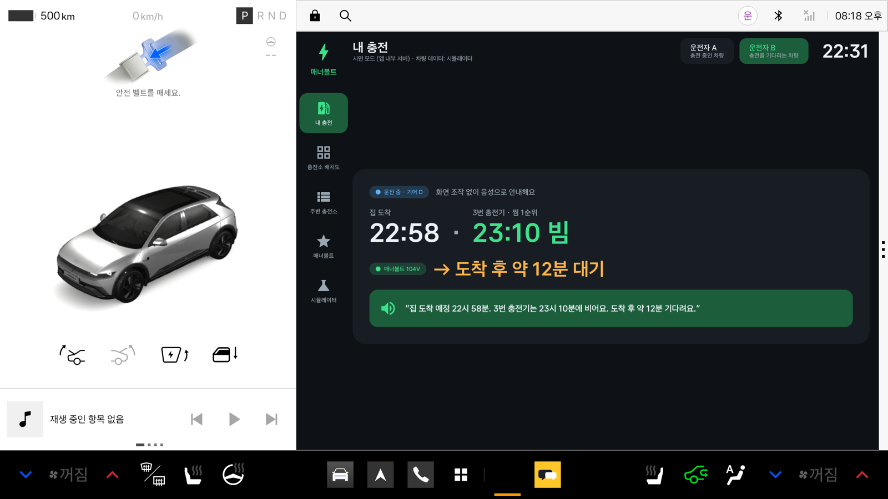 | 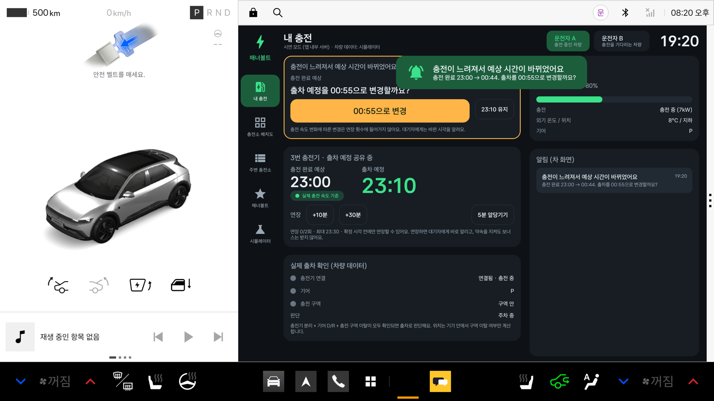 | 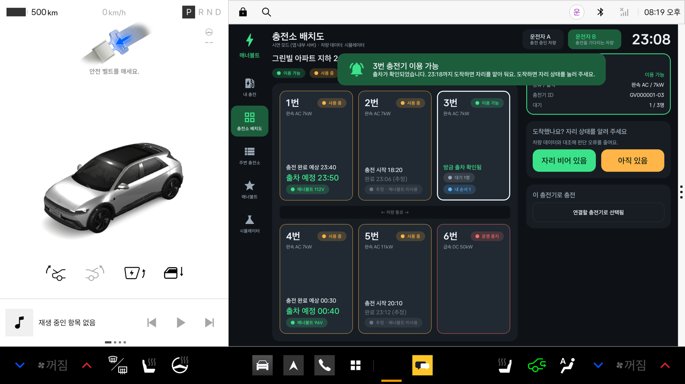 |

| 매너볼트 | 유예 만료 시 대체 안내 | 찜 자동 취소 |
|---|---|---|
| 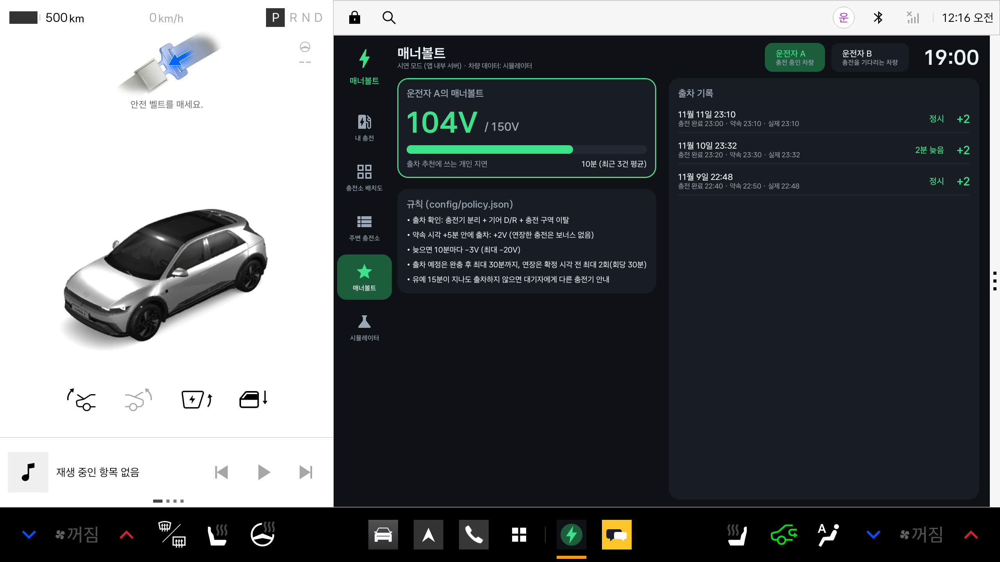 | 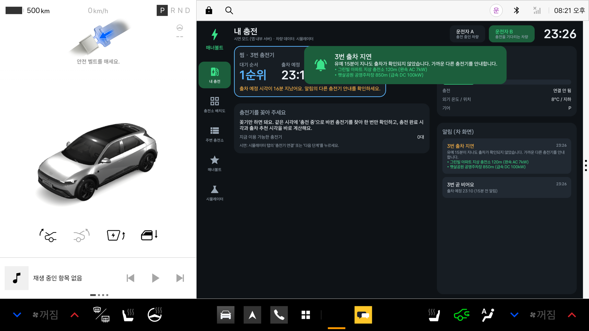 | 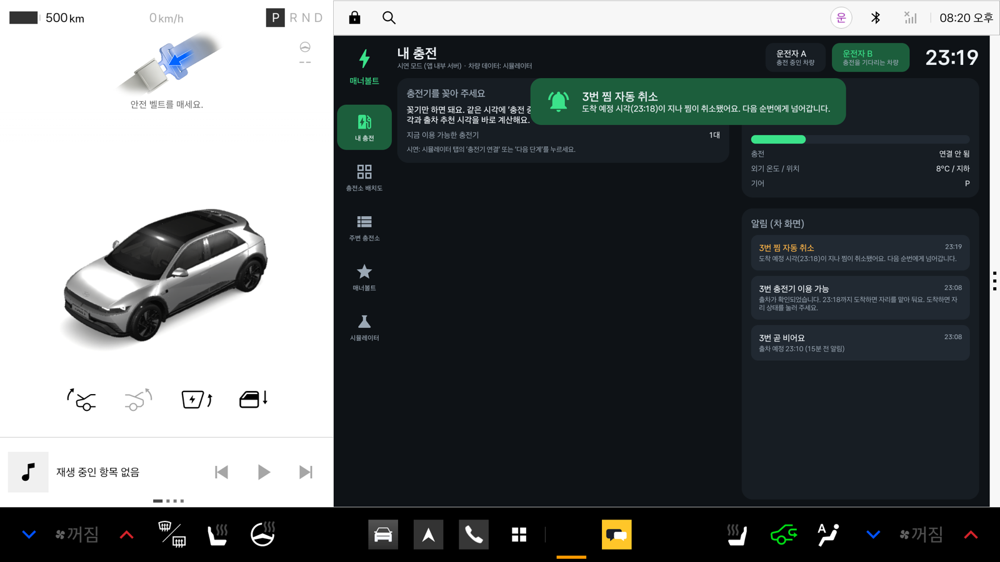 |

## 두 대 시연 (영상 촬영용)

에뮬레이터 두 대를 나란히 띄워 A 차량과 B 차량을 동시에 보여 줍니다. A가 충전기를 빼고 출발하는 순간 B 화면에 "3번 충전기 이용 가능"이 뜨는 장면을 한 화면에 담을 수 있습니다.

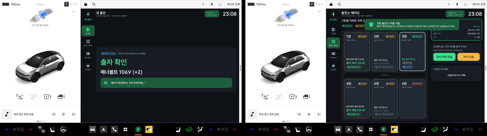

```bash
demo/run-two-cars.sh      # 시연 서버 + 에뮬레이터 두 대 + 설치/실행 + 감독 패널
demo/stop-two-cars.sh     # 정리 (앱을 한 대 시연 모드로 되돌림)
```

- **시연 서버** ([demo/demo_server.py](demo/demo_server.py)): Mac에서 실행하는 로컬 서버입니다. AWS 백엔드와 같은 `backend/src/core.py` 규칙을 메모리 저장소로 돌리고, 시뮬레이션 시각을 두 차량이 공유합니다. 127.0.0.1에만 열리고 API 키가 필요 없습니다.
- **감독 패널** (`http://127.0.0.1:8787/director`): 시나리오 진행, 대체 흐름, 시각 이동, 차량 조작을 브라우저에서 합니다. 차 화면에는 시연 조작 버튼이 나오지 않으니, 감독 패널은 녹화 영역 밖에 두세요.
- **차량 화면**: `emulator-5554`는 운전자 A, `emulator-5556`은 운전자 B로 고정되고 시뮬레이터 탭과 역할 전환 버튼이 숨겨집니다. ① 단계의 "맞아요", "출차로 확정"은 A 화면에서 직접 터치하면 영상에 자연스럽게 담깁니다.
- 같은 AVD를 두 번 띄우기 위해 두 대 모두 `-read-only`로 실행합니다. 에뮬레이터 하나가 약 4GB를 쓰므로 촬영 중에는 Android Studio를 닫아 두는 것이 좋습니다.
- 운전 중 음성 안내까지 담으려면 Mac의 시스템 소리를 녹화할 수 있는 OBS 등을 쓰세요. QuickTime 화면 녹화로는 소리가 담기지 않습니다.
- 두 대 모드는 디버그 빌드에서만 켜지고, 평문 HTTP는 `10.0.2.2`(에뮬레이터에서 본 Mac)에만 허용합니다. 릴리스 APK는 영향이 없습니다.

## 시연 시나리오 (기획서 4항)

| 단계 | 시각 | 화면 | 일어나는 일 |
|---|---|---|---|
| ① | 19:00 | 운전자 A · 내 충전 | 충전기를 꽂으면 같은 시각에 '충전 중'이 된 충전기를 찾아 **"3번 충전기 맞나요?"** → 맞아요 → 완료 **23:00**(추정), 출차 **23:10** 추천 → 한 번 터치로 확정 |
| ①' | 19:10 | 운전자 A | 실제 배터리 상승 속도로 다시 계산 → "예상 그대로 23:00" |
| ② | 22:30 | 운전자 B · 배치도 | 퇴근 전 3번(23:10 빔, 매너볼트 104V)을 찜. 내비 도착 예정(22:58)도 함께 보냄. 매너볼트 미사용 차량은 "완료 추정"만 |
| ②' | 22:31 | 운전자 B · 운전 중 | 터치 없는 카드 한 장 + 음성: **"집 도착 22:58 · 3번 23:10 빔 → 도착 후 약 12분 대기"** |
| ②'' | 22:55 | 운전자 B · 운전 중 | 출차 15분 전 "3번 곧 비어요"를 음성으로 안내 |
| ③ | 23:00 | 운전자 A | "충전 완료, 충전기를 분리하고 이동해 주세요" |
| ③' | 23:08 | 운전자 B | A가 충전기 분리 + 기어 D + 구역 이탈 → 출차 확인 → B에게 "3번 이용 가능, 23:18까지 도착하면 자리를 맡아 둬요" |
| ③'' | 23:12 | 운전자 B · 배치도 | B가 "자리 비어 있음" → 기록 확정 |
| ④ | | 운전자 A · 매너볼트 | 약속 23:10, 실제 23:08 → **104V → 106V**, 출차 기록이 다음 추천에 반영 |

**대체 흐름** 버튼
- 충전이 느려짐: 실제 출력이 70%면 몇 분 뒤 다시 계산해 "충전이 느려져서 예상 시간이 바뀌었어요. 00:55로 변경할까요?"를 묻습니다. 이 변경은 연장 횟수에 들어가지 않습니다.
- 유예 만료: A가 유예 15분이 지나도 출차하지 않으면 B에게 같은 단지 지상 충전소, 근처 공영주차장 등 다른 충전기를 안내합니다.
- 찜 자동 취소: B가 도착 예정 + 10분 안에 오지 않으면 찜이 취소되고 다음 순번에게 넘어갑니다.
- 화면 오른쪽 위에서 **운전자 A / 운전자 B**를 바꿔 두 차량의 화면을 번갈아 볼 수 있습니다.
- 시뮬레이터 탭에서 시간 배속(1·60·600배), 시각 이동, 충전기 연결/분리, 구역 이탈, SoC, 외기 온도를 직접 조작할 수 있습니다.

## Pleos Connect 연동

| 항목 | 값 |
|---|---|
| 에뮬레이터 | Pleos Connect v2.1.0 (Android 14, API 34, arm64-v8a) |
| SDK | `ai.pleos.playground:Vehicle:2.3.2` |
| SDK | `ai.pleos.playground:NaviHelper:3.0.5`, `ai.pleos.playground:TextToSpeech:3.3.1` |
| 사용 API | `EvBattery` 배터리 SoC 조회/구독, 충전구 열림 조회/구독, 충전 스위치 상태 · `Gear` 기어 조회/구독 · `NaviHelper` 목적지 남은 시간(`DestinationInfo.remainTime`) · `TextToSpeech` 운전 중 음성 안내(ko-KR) |
| 권한 | `pleos.car.permission.CAR_ENERGY`, `CAR_DRIVE`, `CAR_INFO`, `NAVI_ROUTE`, `NAVI_NOTIFY`, `TTS_SERVICE` (에뮬레이터에서 자동 허용), `ACCESS_FINE_LOCATION` |

- 차량 데이터는 [`PleosVehicleDataSource`](app/src/main/java/com/mannervolt/vehicle/PleosVehicleDataSource.kt)에서 `initialize → get + register → unregister → release` 순서로 다룹니다. 시뮬레이터 탭의 "Pleos Vehicle SDK" 패널에 실시간 값이 표시됩니다.
- **실제 차량 데이터 사용** 스위치를 켜면 A의 SoC, 충전기 연결(충전구), 기어는 Pleos SDK 값을, 위치는 GPS를 쓰고, B의 집 도착 예정은 Pleos 내비(NaviHelper)에서 읽습니다.
- 기어가 D/R이면 터치할 요소가 없는 카드 한 장만 보여 주고, 새 알림은 Pleos TTS로 읽습니다. Pleos에는 표준 Android TextToSpeech 엔진이 없어서 Gleo AI TTS(`Locale.KOREA`)를 씁니다.
- SDK에 타입 API가 없는 값(충전 상태 enum, 외기 온도, 충전 출력, 지하/실외)은 시뮬레이터 값과 충전소 정보로 채웁니다.

## 소스에서 빌드하기

필요한 것: Android Studio (JDK 17 이상), Android SDK 34, 인터넷 연결 (Pleos SDK를 `https://nexus-playground.pleos.ai/repository/maven-releases/`에서 받습니다. `settings.gradle.kts`에 등록되어 있습니다).

```bash
./gradlew :app:assembleDebug          # app/build/outputs/apk/debug/app-debug.apk
./gradlew :app:testDebugUnitTest      # 단위 테스트 + 속성 기반 테스트
./gradlew :app:assembleRelease        # 설치 가능한 APK (디버그 키 서명)
```

Android Studio에서는 폴더를 열고 실행 대상으로 Pleos Connect v2.1.0 에뮬레이터를 고른 뒤 Run을 누르면 됩니다.

## 구조

```text
app/                         차량 앱 (Kotlin, Jetpack Compose)
  domain/                    순수 규칙: 충전 완료 예측, 출차 추천, 매너볼트 점수, 출차 판단
  vehicle/                   Pleos Vehicle SDK, 가상 차량, GPS 구역 판단
  backend/                   서버 계약, LocalServer(시연), RemoteBackend(AWS)
  ui/                        내 충전 · 충전소 배치도 · 주변 충전소 · 매너볼트 · 시뮬레이터
backend/                     AWS SAM: API Gateway + Lambda(Python 3.12) + DynamoDB
config/policy.json           매너볼트 정책 값 (앱과 서버가 같은 값 사용)
aidlc-docs/                  요구사항, 설계 문서
```

앱은 두 가지 모드로 동작합니다.

- **시연 모드** (기본): 앱 안의 `LocalServer`가 AWS 백엔드와 같은 규칙을 적용합니다. 네트워크 없이 에뮬레이터에서 바로 시연할 수 있습니다.
- **서버 연결 모드**: `local.properties`에 `MANNERVOLT_API_BASE_URL=https://...`를 넣고 빌드하면 AWS 백엔드를 씁니다. 충전소 정보는 한국환경공단 공공 API에서 가져옵니다.

### 주변 충전소 지도

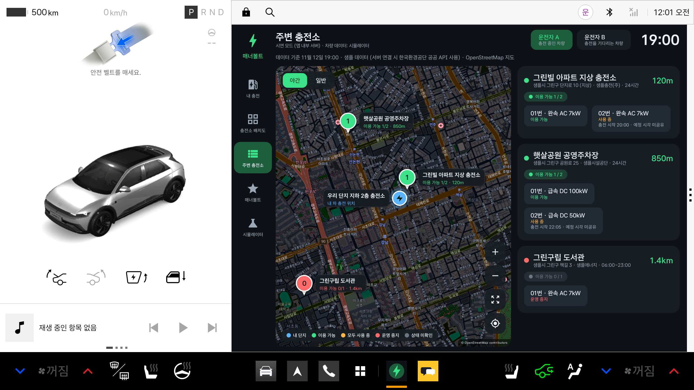

- **주변 충전소** 탭은 실제 지도 위에 단지 충전소와 주변 충전소를 핀으로 보여 줍니다. Pleos 에뮬레이터에는 Google Play 서비스가 없어서 osmdroid 타일 지도를 씁니다.
- 지도 타일: `local.properties`에 `VWORLD_API_KEY`(브이월드, 국토교통부 공간정보 오픈플랫폼)가 있으면 브이월드 야간/일반/위성 지도를, 없으면 OpenStreetMap 지도를 씁니다.
- 시연 모드의 주변 충전소는 샘플 데이터(가상 단지 주변)를 씁니다. 지도 타일을 받으려면 인터넷 연결이 필요합니다.

### 주요 규칙 (`config/policy.json`에서 조정)

- 충전기 매칭: 꽂은 시각 ±5분 안에 공공데이터 상태가 '충전 중'이 된(`nowTsdt`), 아직 약속이 없는 충전기가 후보. 1개면 한 번만 묻고, 여러 개면 목록, 없으면 전체 목록에서 고릅니다.
- 충전 완료 = 시작 + 필요 에너지 ÷ (충전기 출력 × 효율 0.9 × 온도 계수). 지하는 외기 온도 영향을 줄여 계산하고, 급속은 80% 이후 출력이 절반입니다. 꽂은 직후에는 이 값을 '추정'으로 보여 주고, 4분 뒤부터 실제 배터리 상승 속도로 다시 계산합니다. 5분 이상 달라지면 확정 전에는 자동 반영, 확정 후에는 변경을 묻습니다.
- 출차 추천 = 충전 완료 + 최근 10회 평균 지연(기록 없으면 10분), 5분 단위 올림. 단 **완충 + 30분**과 법정 충전 시간 기준(급속 1시간, 완속 14시간)을 넘지 않습니다.
- 연장: 확정 시각 전에만, 최대 2회, 한 번에 최대 30분. 대기자에게 바로 알리고, 연장한 충전은 약속을 지켜도 보너스가 없습니다.
- 매너볼트: 초기 100V, 약속 +5분 안에 출차하면 +2V, 늦으면 10분마다 −3V(최대 −20V).
- 찜(대기): 한 사람당 1곳. 충전기가 빈 뒤 도착 예정(없으면 빈 시각) + 10분 안에 오지 않으면 자동 취소하고 다음 순번에게 알립니다.
- 출차 판단: 충전기 분리 + 기어 D/R + 충전 구역 이탈이 모두 있으면 확정. 일부만 있으면 "이동 감지"로 두고 확정하지 않습니다.
- 매너볼트를 쓰지 않는 차량: 공공데이터 충전 시작 시각 기준 완료 추정만 '추정' 라벨로 보여 주고 매너볼트는 없습니다.
- 알림은 차 화면에서만 보여 줍니다. 차에 없는 동안 온 알림은 다음에 탈 때 보여 줍니다. 휴대폰 알림(블루링크, 문자)은 범위 밖이고, Pleos의 휴대폰 푸시 가능 여부는 확인이 필요합니다.

## 백엔드 배포 (선택)

```bash
cd backend
sam build && sam deploy --guided      # 출력의 ApiBaseUrl 을 MANNERVOLT_API_BASE_URL 로 사용
aws secretsmanager put-secret-value --secret-id <PublicApiSecretArn> --secret-string '<공공데이터포털 서비스키>'
```

- 파라미터 `HomeStationId`(단지 충전소 statId), `NearbyStationIds`(쉼표로 구분)로 조회할 충전소를 정합니다. 서버는 충전소별로 공공 API를 조회하고 결과가 많으면 다음 페이지도 받습니다. 철거된 충전기(`delYn=Y`)는 빼고, `floorType=B`이면 지하 충전소로 보고 충전 완료 예측에 반영합니다. 공공 API에 없는 충전소 ID(기본값 `GV000001`)는 샘플 데이터를 씁니다.
- 공공 API 응답 필드는 실제 키로 확인했습니다. 다시 확인하려면 저장소 루트의 `.env.local`에 키를 넣고 `python3 backend/tools/probe_public_api.py [statId ...]`를 실행합니다. 키는 출력하지 않습니다.
- 백엔드 테스트: `cd backend && python3 -m unittest discover -s tests`

## 개인정보와 보안

- **위치**: 좌표는 기기 안에서만 쓰고, 서버에는 "충전 구역을 벗어났는지" 여부만 보냅니다. 다른 사용자에게 위치를 보여 주지 않습니다. 내비 목적지 이름도 서버로 보내지 않고 도착 예정 시각만 보냅니다.
- **다른 차량 표시**: 차량 번호 없이 '충전기 번호 + 매너볼트'만 보여 줍니다.
- **익명 식별**: 서버가 만든 무작위 기기 ID를 씁니다. VIN이나 번호판은 쓰지 않습니다.
- **비밀 값**: 공공 API 키와 토큰 서명 키는 AWS Secrets Manager에만 있습니다. APK와 저장소에는 비밀 값이 없습니다.
- **인증과 권한**: 모든 API는 서버가 서명한 토큰이 필요하고, 출차 보고와 시각 변경은 해당 충전의 주인만 할 수 있습니다.
- **오용 방지**: "자리 비어 있음" 신고 한 번으로는 충전기 상태를 바꾸지 않고, 서로 다른 기기 2대 이상의 신고가 필요합니다. 기기당 대기는 1곳, 출차 시각 변경은 충전 1회당 5번까지입니다. API 속도 제한을 둡니다.
- **저장과 기록**: DynamoDB 저장 시 암호화, HTTPS만 허용, 출차 시각과 점수 변경은 감사 기록으로 남깁니다. 로그는 90일 보관하고 토큰, 좌표, 키는 기록하지 않습니다.

## 테스트

| 종류 | 위치 | 내용 |
|---|---|---|
| 속성 기반 테스트 (Kotest) | `app/src/test/.../DomainPropertyTest.kt` | 완료 시각 ≥ 시작, SoC가 높으면 더 빨리 끝남, 추천은 완료 이후이며 5분 단위, 점수 범위 유지, 늦을수록 점수가 좋아지지 않음, 출차 상한(완충 + 30분, 법정 기준), 연장 규칙, 연장 시 보너스 없음, 재계산 완료 시각의 단조성, 출차 확정에 세 신호 모두 필요 |
| 직렬화 왕복 | `SerializationRoundTripTest.kt` | 앱-서버 데이터 JSON 왕복 |
| 시나리오 | `ScenarioTest.kt`, `backend/tests/test_core.py` | 기획서 4항 흐름, 충전기 매칭, 상한·연장·재계산, 찜 자동 취소, 매너볼트 미사용 차량 표시, 권한, 허위 신고 방어, 앱-서버 정책 값 일치 |

## 범위 밖

스마트폰 보조 앱과 휴대폰 알림(블루링크, 문자), 야간 모드, 결제와 충전 제어, 비충전 차량 신고 기능(향후 확장), 실서비스 운영 배포.
